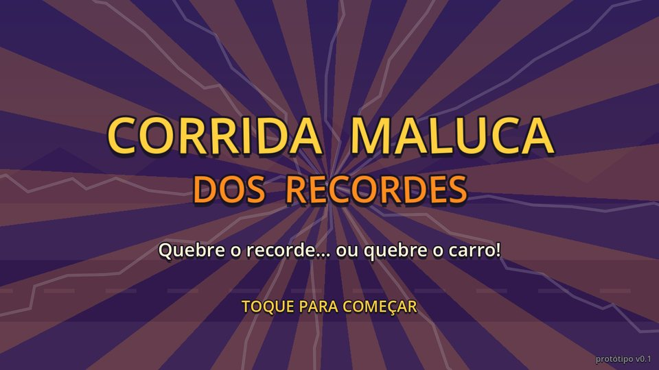
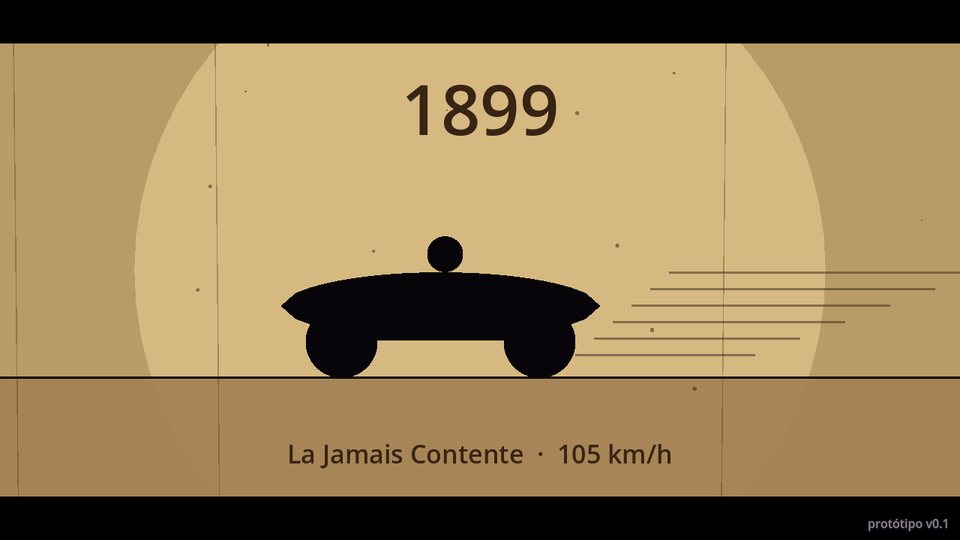
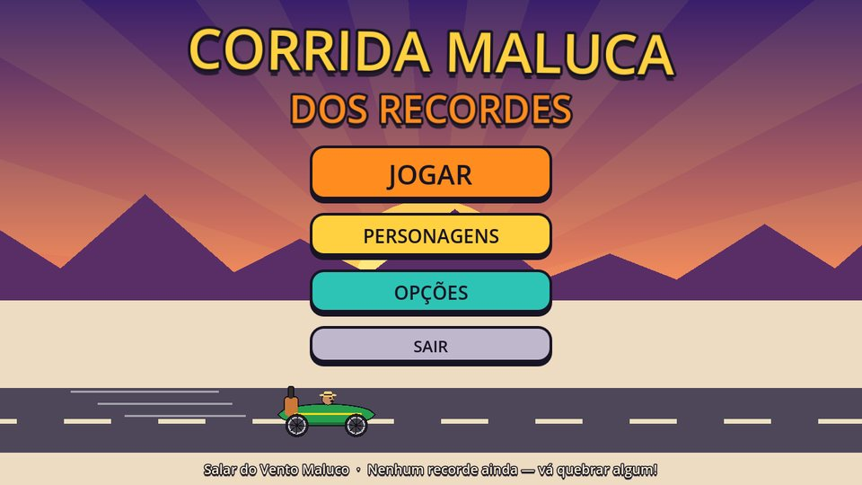
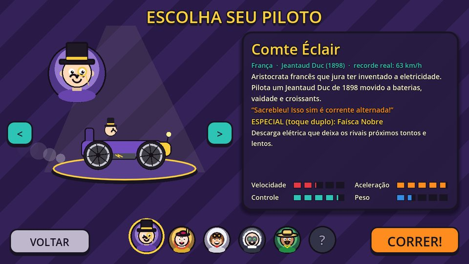
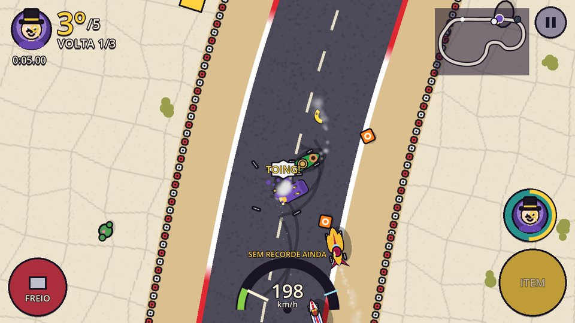
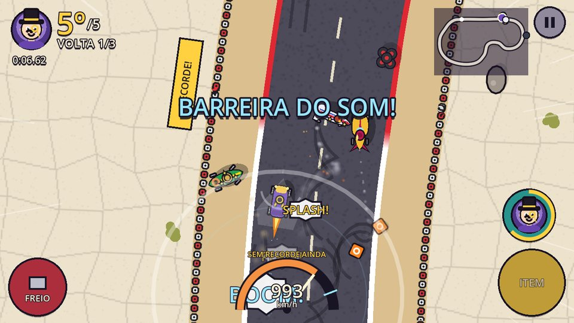
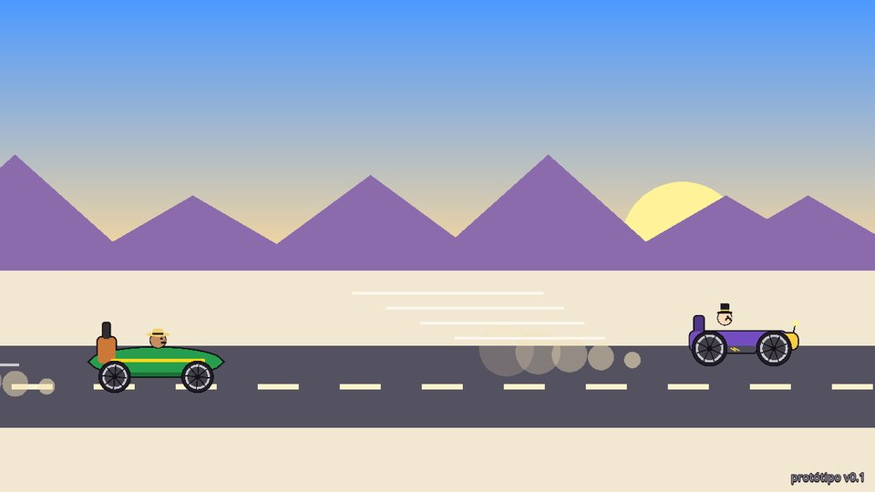
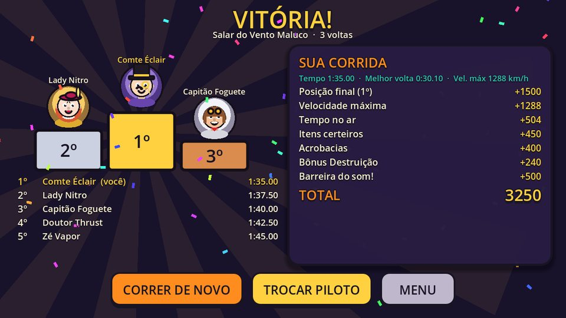

# 🏁 Corrida Maluca dos Recordes

[](https://github.com/bda-dev/corridaMaluca/actions/workflows/smoke-test.yml)

> *"Quebre o recorde… ou quebre o carro!"*

Protótipo de jogo **mobile 2D** de corrida maluca (estilo desenho animado de corrida maluca)
estrelado pelos **carros históricos de recorde de velocidade em terra** — Jeantaud Duc,
La Jamais Contente, Golden Arrow, Blue Bird, Spirit of America e ThrustSSC — em versões
cartoon exageradas, com física cômica, power-ups absurdos e muito *BOING!*.

Feito em **Godot 4** (GDScript, renderizador *Compatibility*), pensado para **Android em paisagem**,
mas jogável no PC com mouse/teclado.

| | |
|---|---|
|  |  |
|  |  |
|  |  |
|  |  |

*(capturas reais do jogo com os placeholders procedurais — nenhum asset baixado)*

---

## ✅ O que já está pronto

| Escopo pedido | Status | Onde |
|---|---|---|
| 1. Tela de título + abertura cinemática (12–18 s, pula com toque) | ✅ ~15 s | `scenes/Intro.tscn` |
| 2. Menu principal (Jogar, Personagens, Opções) | ✅ | `scenes/MainMenu.tscn` |
| 3. Seleção de personagem/carro (+ galeria) | ✅ 5 pilotos + 1 "em breve" | `scenes/CharacterSelect.tscn` |
| 4. Pista completa jogável | ✅ "Salar do Vento Maluco", 3 voltas | `scenes/race/tracks/SalarDoVento.tscn` |
| 5. Física exagerada e cômica | ✅ drift, saltos, giros no ar, carro que desmonta e remonta | `scripts/race/Car.gd` |
| 6. Power-ups e efeitos | ✅ 6 itens + 5 especiais | `scripts/race/PowerUps.gd` |
| 7. HUD mobile-friendly | ✅ multi-toque, minimapa, velocímetro | `scripts/ui/RaceHUD.gd` |
| 8. Score / recordes | ✅ salvos em `user://` | `GameManager.gd` |
| 9. Tela de resultado | ✅ pódio, pontuação animada, carimbo de recorde | `scenes/Results.tscn` |

**Nenhum asset externo é obrigatório**: todos os gráficos são desenhados por código e todos os sons
e músicas são sintetizados em tempo de execução. Quando você colocar os assets do Kenney nas pastas
certas, eles substituem os placeholders automaticamente (ver [docs/ASSETS_KENNEY.md](docs/ASSETS_KENNEY.md)).

---

## ▶️ Como rodar

1. Baixe o **Godot 4.3+** (Standard): https://godotengine.org/download
2. Abra o Godot → **Importar** → selecione `project.godot` desta pasta.
   *(Na 1ª abertura o editor registra as classes do projeto — aguarde o fim da importação.)*
3. Aperte **F5**. A intro começa; toque/clique para pular.

No celular: veja **[docs/ANDROID_EXPORT.md](docs/ANDROID_EXPORT.md)** (passo a passo com USB e APK).

## 🎮 Controles

| Ação | Celular | PC |
|---|---|---|
| Acelerar | **segurar** o dedo na tela | segurar o botão do mouse · `W` / `↑` |
| Virar | **arrastar** para esquerda/direita | arrastar o mouse · `A D` / `← →` |
| Especial do piloto | **toque duplo** (ou botão redondo com o retrato) | duplo clique · `Shift` / `Q` |
| Usar item | botão **ITEM** (amarelo) | `Espaço` / `E` |
| Frear / ré / drift | botão **FREIO** (freio + curva = derrapagem longa) | `S` / `↓` |
| Pausa | botão ❚❚ ou "voltar" do Android | `Esc` / `P` |
| Giroscópio | Opções → *Giroscópio para virar* | — |

*Dica*: segure para acelerar **só depois que aparecer o "1"** → **LARGADA TURBO**. Segurar cedo demais… engasga.

## 🧑‍✈️ Pilotos

| Piloto | Carro (recorde real) | Perfil | Especial (toque duplo) |
|---|---|---|---|
| **Comte Éclair** 🇫🇷 aristocrata | Jeantaud Duc · 1898 · 63 km/h | acelera muito, velocidade baixa | **Faísca Nobre** — choque elétrico atordoa quem está perto |
| **Lady Nitro** 🇬🇧 elegante | Golden Arrow · 1929 · 372 km/h | equilibrada | **Nitro Real** — turbo de 3 s com escudo |
| **Capitão Foguete** 🇺🇸 exagerado | Spirit of America · 1965 · 966 km/h | rápido, curva aberta | **Pós-Combustão** — dispara e arremessa quem vem atrás |
| **Doutor Thrust** 🧪 cientista louco | ThrustSSC · 1997 · 1.228 km/h | o mais rápido, derrapa muito, pesado | **Teleporte Experimental** — salta pela pista (20% de "OPS!") |
| **Zé Vapor** 🇧🇷 inventor | La Jamais Contente (a vapor) · 1899 · 105 km/h | aderência alta, pesado | **Nuvem de Vapor** — atola quem vem atrás + empurrãozinho |
| *??? (em breve)* | Blue Bird · 1935 · 484 km/h | — | — |

## 💥 Power-ups (caixas "?")

Quem está mais atrás sorteia itens mais fortes.

| Item | Efeito |
|---|---|
| **Óleo** | poça escorregadia para trás — quem passa rodopia |
| **Banana** | o clássico |
| **Foguete** | teleguiado no carro da frente: explode, desmonta e joga o rival para o ar |
| **Ímã** | puxa você até o rival da frente e dá um "estilingue" |
| **Chuva de peças** | engrenagens, rodas e chaves inglesas despencam do céu nos rivais (veja a sombra!) |
| **Barreira do som** | turbo supersônico com cone de vapor + **BOOM** que espalha todo mundo — passa de **MACH 1** no velocímetro |

Na pista também há **rampas** (salto alto; em alta velocidade o carro dá um giro no ar = acrobacia),
**faixas de turbo**, **cones** que voam longe, **pilhas de pneus** e **barris** (bater forte desmonta o carro).

## 🏆 Pontuação e recordes

Pontos = posição (1500/1000/700/450/250) + velocidade máxima (km/h) + tempo no ar ×120 +
itens certeiros ×150 + acrobacias ×200 + **Bônus Destruição** (60 por batida — afinal, quebre o
carro!) + 500 se romper a barreira do som. São salvos por pista: melhor tempo, melhor volta,
**recorde de velocidade** (mostrado no velocímetro durante a corrida), melhor pontuação e vitórias.

---

## 🗂️ Estrutura

```
res://
├── project.godot / export_presets.cfg / icon.svg
├── assets/
│   ├── kenney/            ← packs CC0 do Kenney (vazios: veja os LEIAME.md)
│   │   ├── cars/ (+ objects/)   characters/   ui/   effects/   audio/
│   ├── custom/            ← arte/sons próprios futuros (prioridade sobre o Kenney)
│   └── fonts/
├── data/characters/*.tres ← um arquivo por piloto (CharacterData)
├── scenes/
│   ├── Intro.tscn  MainMenu.tscn  CharacterSelect.tscn  Race.tscn  Results.tscn
│   ├── race/Car.tscn  race/tracks/SalarDoVento.tscn
│   └── ui/HUD.tscn  ui/PauseMenu.tscn
├── scripts/
│   ├── autoload/   GameManager.gd · AudioManager.gd · AssetLib.gd
│   ├── audio/      Synth.gd (SFX e músicas chiptune placeholder)
│   ├── data/       CharacterData.gd · CarArt.gd (arte procedural)
│   ├── intro/      Intro.gd
│   ├── menu/       MainMenu.gd · CharacterSelect.gd
│   ├── race/       Race.gd · Track.gd · Car.gd · CarVisual.gd · PlayerController.gd ·
│   │               AIController.gd · TouchInput.gd · RaceCamera.gd · PowerUps.gd ·
│   │               ItemBox.gd · Ramp.gd · BoostPad.gd · Cone.gd · Obstacle.gd ·
│   │               Hazard.gd · Rocket.gd · FallingPart.gd
│   ├── fx/         RaceFX.gd (onomatopeias, explosões, ondas de choque, raios)
│   ├── ui/         UIStyle.gd · RaceHUD.gd · OptionsPanel.gd · PauseMenu.gd
│   └── results/    Results.gd
├── docs/           ASSETS_KENNEY.md · ANDROID_EXPORT.md · screenshots/
├── tests/          SmokeTest.tscn (teste automático) · Screenshots.tscn (capturas)
└── tools/          kenney_import.py (copia os arquivos dos packs para os nomes certos)
```

### Fluxo de cenas

```
Intro ──toque──► MainMenu ──Jogar──► CharacterSelect ──Correr!──► Race ──fim──► Results
                    │  └─Personagens─► CharacterSelect (modo galeria)            │
                    └─Opções (painel)                     ◄──Menu / Correr de novo┘
```

### Autoloads

* **GameManager** — elenco (`ROSTER_PATHS`), piloto escolhido, configurações, recordes
  (`user://corrida_maluca_save.cfg`), `go_to("cena")` com fade, cálculo de pontuação.
* **AssetLib** — único ponto de troca de assets (chave lógica → arquivo, com fallback).
* **AudioManager** — pool de efeitos, música com fade, motor do jogador; sintetiza o que faltar.

### Como a corrida funciona

* A pista é **uma curva fechada** (`Path2D`). `Track.gd` gera asfalto, zebras, acostamento,
  barreira de pneus com colisão (`Geometry2D.offset_polyline`), linha de chegada, decoração e objetos.
* Os carros são `CharacterBody2D` com física arcade própria: aderência lateral baixa = drift;
  altura falsa `z` para saltos (no ar mudam de camada de colisão e passam por cima de tudo).
* Volta/posição = progresso na curva + 2 checkpoints anti-atalho. A IA segue a curva com
  "olhar à frente", troca de faixa, freia em curvas, se desatola e tem *rubber band* leve.

## 🔧 Como expandir

* **Novo piloto**: duplique um `.tres` em `data/characters/`, edite no Inspector (cores, chapéu,
  física, especial) e adicione o caminho em `GameManager.ROSTER_PATHS`. Para um especial novo,
  crie um `case` em `PowerUps.use_special()`. O Blue Bird já tem desenho pronto (`car_shape = "blue_bird"`).
* **Nova pista**: duplique `scenes/race/tracks/SalarDoVento.tscn`, edite a curva do nó `Path`
  no editor e ajuste no Inspector as frações de itens, rampas, turbos e obstáculos.
  Em `Race.tscn`, troque a instância de `World/Track`.
* **Novo item**: adicione o id em `PowerUps.ALL/INFO/_weights`, implemente em `use_item()`
  e desenhe o ícone em `draw_icon()`.

## ⚠️ Observações deste protótipo

* Testado no **Godot 4.4.1** (headless + renderização OpenGL via Xvfb): todas as cenas carregam
  sem erros de script e uma corrida completa de 3 voltas termina com os 5 carros.
* **Teste de fumaça** — abre todas as telas, simula toques reais (pular intro, segurar para acelerar,
  arrastar para virar, ITEM com outro dedo, FREIO, toque duplo) e roda uma corrida inteira no
  piloto automático; sai com código ≠ 0 se algo falhar:
  ```bash
  godot --headless --path . res://tests/SmokeTest.tscn
  ```
  (ou abra `tests/SmokeTest.tscn` no editor e aperte **F6**).
  O mesmo teste roda no **GitHub Actions** a cada push na `main` e em todo PR
  (`.github/workflows/smoke-test.yml`): baixa o Godot 4.4.1 (hash SHA-512 conferido), importa o
  projeto e falha se o teste reportar FAIL/TIMEOUT ou se o log tiver qualquer `SCRIPT ERROR`.
* **Screenshots** de todas as telas (precisa de vídeo; no Linux sem tela use `xvfb-run`):
  ```bash
  godot --path . res://tests/Screenshots.tscn -- --out=/tmp/shots
  ```
* Balanceamento (velocidades, aderência, IA) é um ponto de partida — os números estão concentrados
  nos `.tres` dos pilotos e nas constantes do topo de `Car.gd`.
* Próximos passos sugeridos: mais pistas, Blue Bird jogável, fantasma do recorde (ghost car),
  arte final em `assets/custom/`, ranking online.

---

Assets de terceiros: packs do **Kenney** (kenney.nl), licença **CC0**. Os nomes dos carros e
recordes citados são fatos históricos; todos os personagens são originais deste projeto.
